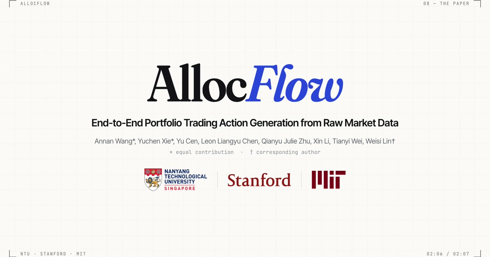

<p align="center">
  <a href="https://allocflow.github.io/"></a>
</p>

<h3 align="center">Project page for <a href="https://allocflow.github.io/">AllocFlow</a></h3>

<p align="center">
  <a href="https://allocflow.github.io/"></a>
  <a href="https://arxiv.org/abs/2611.19937"></a>
  <a href="https://github.com/allocflow/AllocFlow"></a>
</p>

This repository hosts the static source of the AllocFlow project page. It needs no build step: plain HTML, CSS and JavaScript.

```bash
npx serve .        # or: python3 -m http.server 8000
```

| Path | Contents |
|:--|:--|
| `index.html` | the page |
| `assets/js/flow.js` | the hero wordmark and the interactive flow-matching lab, both driven by the exact marginal velocity field of a Gaussian mixture |
| `assets/js/main.js` | the results chart, tables and reveal animations |
| `assets/data/pnl.js` | cumulative PnL series digitized from Figure 1 of the paper |
| `assets/video/` | the two-minute explainer, in English and with bilingual subtitles |
